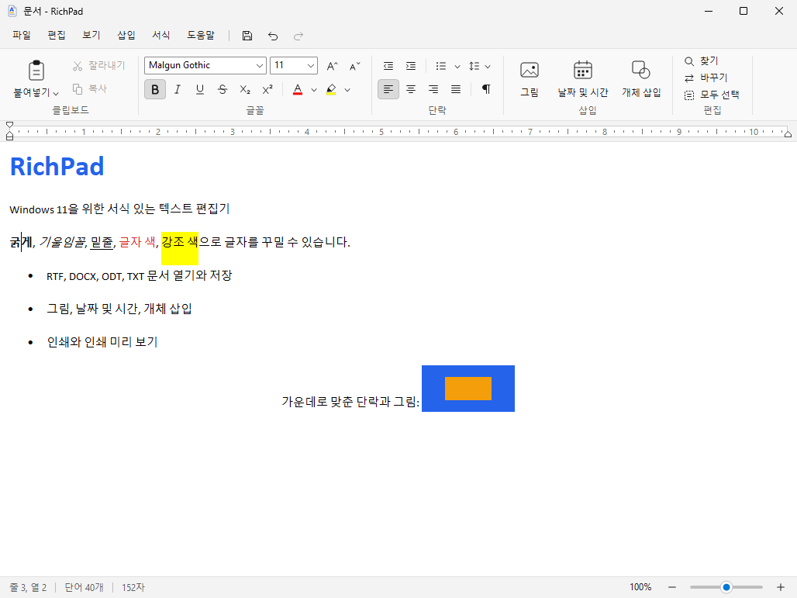
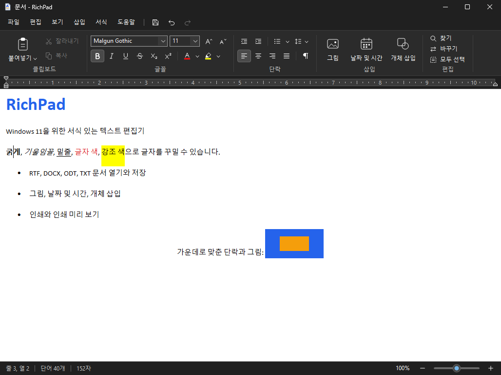

# RichPad

RichPad는 Windows 11에서 사용할 수 있는 서식 있는 텍스트 편집기입니다. Windows 11 24H2부터 워드패드가 운영 체제에서
제거되었기 때문에, 워드패드가 제공하던 기능을 Windows 11에 어울리는 화면으로 다시 사용할 수 있도록 새로 작성했습니다.

RichPad는 독립적으로 제작된 프로그램이며 Microsoft와 관련이 없습니다. 워드패드의 코드나 아이콘은 사용하지 않았습니다.





## 주요 기능

- **문서 형식**: RTF, DOCX(Office Open XML), ODT(OpenDocument), 일반 텍스트(UTF-8, UTF-16, ANSI)를 열고 저장합니다.
- **글자 서식**: 글꼴, 크기, 굵게, 기울임꼴, 밑줄, 취소선, 위 첨자와 아래 첨자, 글자 색, 강조 색, 서식 지우기를 지원합니다.
- **단락 서식**: 맞춤, 들여쓰기, 줄 간격, 단락 뒤 공백, 글머리 기호와 번호 목록, 탭 위치를 지정할 수 있습니다.
- **눈금자**: 첫 줄 들여쓰기, 내어쓰기, 왼쪽 및 오른쪽 여백 표식을 끌어서 조정하고, 눈금자를 눌러 탭 위치를 추가합니다.
- **삽입**: 그림(PNG, JPEG, GIF, BMP, TIFF), 날짜 및 시간, OLE 개체를 삽입하며, 그림 크기를 조정할 수 있습니다.
- **편집**: 찾기와 바꾸기, 여러 단계의 실행 취소와 다시 실행, 선택하여 붙여넣기, 서식 없이 붙여넣기를 제공합니다.
- **링크**: 입력한 웹 주소를 자동으로 링크로 표시하고, DOCX와 ODT 문서에 포함된 링크를 유지합니다.
  링크 위에 마우스 포인터를 올리면 상태 표시줄에 주소가 표시되며, Ctrl 키를 누른 채로 클릭하면 링크가 열립니다.
- **인쇄**: 페이지 설정, 인쇄, 빠른 인쇄, 인쇄 미리 보기(한 페이지 또는 두 페이지, 확대와 축소)를 지원합니다.
- **보기**: 10%에서 500%까지 확대하거나 축소할 수 있고, 자동 줄 바꿈 방식(창에 맞춤, 눈금자에 맞춤, 줄 바꿈 안 함)과
  측정 단위(인치, 센티미터, 포인트, 파이카)를 선택할 수 있습니다.
- **화면**: 밝은 테마와 어두운 테마를 제공하며 시스템 설정을 따르도록 지정할 수 있습니다. 모니터마다 배율이 다른
  환경(Per-Monitor DPI)에서도 선명하게 표시됩니다.
- **언어**: 한국어와 영어 화면을 제공하며, 기본값은 Windows 표시 언어를 따릅니다.

## 내려받기와 실행

RichPad는 설치 과정이 필요하지 않은 단일 실행 파일(`RichPad.exe`)입니다. 별도의 런타임이나 라이브러리를 설치할 필요가
없으며, Windows 10(버전 1607 이상)과 Windows 11(x64, ARM64)에서 실행됩니다.

1. 이 저장소의 **Actions** 탭에서 가장 최근에 성공한 **Build** 실행 항목을 엽니다.
2. 화면 아래쪽 **Artifacts** 영역에서 `RichPad-x64`(일반 PC) 또는 `RichPad-ARM64`(ARM 기기)를 내려받습니다.
3. 압축을 풀고 `RichPad.exe`를 원하는 폴더에 복사한 다음 실행합니다.

아티팩트는 GitHub에 로그인한 상태에서만 내려받을 수 있으며 90일 동안 보관됩니다. 보관 기간이 지났다면 Actions 탭에서
**Build** 워크플로를 다시 실행하거나, 아래의 방법으로 직접 빌드하면 됩니다.

실행 파일에는 코드 서명이 되어 있지 않습니다. 그래서 인터넷에서 내려받은 파일을 처음 실행할 때 Windows의
SmartScreen이 경고를 표시할 수 있으며, 이 경우에는 [추가 정보]를 누른 다음 [실행]을 선택하면 됩니다.

문서 파일을 RichPad로 열고 싶다면 [도움말] 메뉴의 [파일 형식 연결]을 사용합니다. 이 기능은 현재 사용자 계정에 대해서만
RichPad를 `.rtf`, `.docx`, `.odt`, `.txt` 파일의 연결 프로그램 목록에 등록하며, 같은 메뉴에서 등록을 해제할 수 있습니다.
설정과 최근 문서 목록은 레지스트리의 `HKEY_CURRENT_USER\Software\RichPad` 키에 저장됩니다.

## 지원하는 파일 형식

| 형식 | 열기 | 저장 | 비고 |
| --- | --- | --- | --- |
| 서식 있는 텍스트 (`.rtf`) | 예 | 예 | 기본 형식입니다. |
| Office Open XML 문서 (`.docx`) | 예 | 예 | 글자 및 단락 서식, 목록, 표, 그림, 링크를 변환합니다. |
| OpenDocument 텍스트 (`.odt`) | 예 | 예 | 글자 및 단락 서식, 목록, 표, 그림, 링크를 변환합니다. |
| 텍스트 문서 (`.txt`) | 예 | 예 | UTF-8, UTF-16, ANSI 인코딩을 자동으로 판별합니다. |
| Word 97-2003 문서 (`.doc`) | 아니요 | 아니요 | Word에서 `.docx` 또는 `.rtf`로 저장한 다음에 열 수 있습니다. |

## 바로 가기 키

| 키 | 동작 |
| --- | --- |
| Ctrl+N / Ctrl+Shift+N | 새로 만들기 / 새 창 |
| Ctrl+O / Ctrl+S / F12 | 열기 / 저장 / 다른 이름으로 저장 |
| Ctrl+P / Ctrl+F2 | 인쇄 / 인쇄 미리 보기 |
| Ctrl+Z / Ctrl+Y | 실행 취소 / 다시 실행 |
| Ctrl+F / F3 / Shift+F3 | 찾기 / 다음 찾기 / 이전 찾기 |
| Ctrl+H | 바꾸기 |
| Ctrl+Alt+V / Ctrl+Shift+V | 선택하여 붙여넣기 / 서식 없이 붙여넣기 |
| Ctrl+B / Ctrl+I / Ctrl+U | 굵게 / 기울임꼴 / 밑줄 |
| Ctrl+Shift+> / Ctrl+Shift+< | 글꼴 크게 / 글꼴 작게 |
| Ctrl+= / Ctrl+Shift+= | 아래 첨자 / 위 첨자 |
| Ctrl+L / Ctrl+E / Ctrl+R / Ctrl+J | 왼쪽 / 가운데 / 오른쪽 / 양쪽 맞춤 |
| Ctrl+1 / Ctrl+5 / Ctrl+2 | 줄 간격 1.0 / 1.5 / 2.0 |
| Ctrl+Shift+L | 글머리 기호 |
| Ctrl+D | 글꼴 대화 상자 |
| Ctrl+Space | 서식 지우기 |
| Ctrl+휠, Ctrl++ / Ctrl+- / Ctrl+0 | 확대 / 축소 / 100% |
| Ctrl+클릭 | 링크 열기 |
| Alt 또는 F10 | 메뉴 줄로 이동 |

## 명령줄 옵션

```
RichPad.exe [파일]                   지정한 문서를 엽니다.
RichPad.exe /p 파일                  문서를 기본 프린터로 인쇄한 다음 종료합니다.
RichPad.exe /pt 파일 "프린터 이름"   문서를 지정한 프린터로 인쇄한 다음 종료합니다.
RichPad.exe /theme:light|dark        테마를 지정하여 실행합니다.
RichPad.exe /lang:ko|en              화면 언어를 지정하여 실행합니다.
RichPad.exe /selftest 보고서.log     자체 시험을 실행하고 결과를 파일에 기록합니다.
```

## 직접 빌드하기

RichPad는 C++17과 Win32 API만으로 작성했으며 외부 라이브러리를 사용하지 않습니다. 빌드에는 CMake 3.16 이상이 필요합니다.

**Windows (Visual Studio 2022 이상)**

```
cmake -S . -B build -A x64
cmake --build build --config Release
```

빌드가 끝나면 `build\Release\RichPad.exe`가 만들어집니다. ARM64용 실행 파일을 만들려면 `-A ARM64`를 지정합니다.

**Linux에서 교차 컴파일 (MinGW-w64)**

```
sudo apt-get install g++-mingw-w64-x86-64 cmake
cmake -S . -B build-mingw -DCMAKE_TOOLCHAIN_FILE=cmake/mingw-w64-x86_64.cmake -DCMAKE_BUILD_TYPE=Release
cmake --build build-mingw --parallel
```

## 시험

시험은 세 가지로 구성되어 있으며, GitHub Actions(`.github/workflows/build.yml`)가 푸시할 때마다 자동으로 실행합니다.

- **변환기 단위 시험**: DOCX, ODT, RTF 변환 코드는 운영 체제에 의존하지 않도록 작성했기 때문에 Linux에서도 시험할 수
  있습니다. `tests/run_convert_tests.sh`가 AddressSanitizer와 UndefinedBehaviorSanitizer를 켠 상태로 시험을 실행합니다.
- **변환기 퍼징**: `tests/run_convert_fuzz.sh [횟수] [난수 값]`은 견본 문서를 무작위로 손상시킨 다음 변환기에 입력하여,
  손상되었거나 악의적으로 만들어진 파일을 열 때에도 프로그램이 비정상적으로 종료되지 않는지 확인합니다.
- **자체 시험**: `RichPad.exe /selftest 보고서.log`는 실제 주 창을 대상으로 서식 적용, 파일 형식별 저장과 열기, 찾기와
  바꾸기, 그림, 링크, 인쇄(PDF 프린터), 대화 상자, 테마와 언어 전환을 점검하고 화면을 PNG 파일로 저장합니다.
  GitHub Actions는 이 시험을 실제 Windows에서 실행하며, 보고서와 화면 캡처를 `selftest-results` 아티팩트로 보관합니다.

## 소스 구성

| 경로 | 내용 |
| --- | --- |
| `src/main.cpp` | 주 창, 메뉴, 명령 처리, 파일 열기와 저장 |
| `src/editor.cpp` | RichEdit 컨트롤(`msftedit.dll`)과 서식, 찾기, 그림, 개체 처리 |
| `src/commandbar.cpp`, `src/icons.cpp` | 메뉴 줄과 명령 모음, 코드로 직접 그리는 벡터 아이콘 |
| `src/ruler.cpp`, `src/statusbar.cpp`, `src/popups.cpp` | 눈금자, 상태 표시줄, 색 선택 팝업 |
| `src/dialogs.cpp`, `src/print.cpp` | 대화 상자, 인쇄와 인쇄 미리 보기 |
| `src/theme.cpp`, `src/strings.def` | 밝은 테마와 어두운 테마, 한국어와 영어 문자열 |
| `src/convert/` | ZIP, XML, RTF, DOCX, ODT 읽기와 쓰기(운영 체제에 의존하지 않음) |
| `src/selftest.cpp`, `tests/` | 자체 시험과 변환기 단위 시험 |

## 알려진 제한 사항

- RichPad는 워드패드와 같은 수준의 편집기이며 Word를 대체하지는 않습니다. DOCX와 ODT 문서를 열 때에는 RichPad가 지원하는
  내용만 변환하므로 머리글과 바닥글, 각주, 도형, 변경 내용 추적, 수식, 다단 편집과 같은 내용은 표시되지 않습니다.
  이렇게 변환하여 연 문서를 원본 파일에 덮어쓰려고 하면, 내용이 손실될 수 있다는 점을 알리고 다른 이름으로 저장할지 묻습니다.
- 표는 문서에 포함된 내용을 표시하고 편집할 수 있지만, 표를 새로 만들거나 행과 열을 추가하는 기능은 제공하지 않습니다.
- OLE 개체는 RTF로 저장할 때에만 편집 가능한 상태로 유지되며, DOCX와 ODT로 저장할 때에는 그림으로 저장됩니다.
- 맞춤법 검사 기능은 제공하지 않습니다.
- Word 97-2003 이진 형식(`.doc`)은 지원하지 않습니다.
